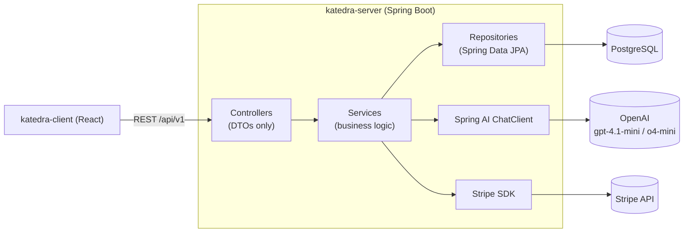

# Katedra Server

[](https://github.com/SAULALEE/katedra-server/actions/workflows/ci.yml)
[](LICENSE)

Backend for **Katedra**, an AI-driven academic content generator for teachers. Give it a
syllabus — typed, uploaded, or from a URL — and it generates the outline, theory, an exam,
and slides, using real OpenAI calls through Spring AI. Spring Boot 4, Java 21, PostgreSQL,
Stripe billing.

Spanish version: [README.md](README.md) · Frontend: [katedra-client](https://github.com/SAULALEE/katedra-client)

---

## Live demo

- **App:** https://katedra-client.vercel.app
- **API:** https://katedra-server.onrender.com/api/v1

> **Demo credentials:** not published yet — see [Demo accounts](#demo-accounts) below.
> The API is hosted on Render's free tier, which suspends the service after a few minutes
> without traffic. An external cron pings `/api/v1/health` every 10 minutes to keep it
> awake, so the demo answers right away; should that ping fail, the first request can
> take up to a minute to bring the service back up.

### Demo accounts

Public registration at `/auth/register` creates teacher accounts on the Free plan; student
accounts use `/auth/students/register`. Email domains never grant administrator privileges.
Existing administrators can create other administrator accounts through user management.
Demo credentials are not published yet.

---

## Architecture



A layered modular monolith: controllers only see DTOs, entities never leave the service
layer, all AI and Stripe calls are async. Details in
[docs/2_ARCHITECTURE_AND_TECH_STACK.en.md](docs/2_ARCHITECTURE_AND_TECH_STACK.en.md).

---

## Tech stack

| | |
|---|---|
| Language / framework | Java 21, Spring Boot 4.0.6 |
| AI | Spring AI `ChatClient` → OpenAI (`gpt-4.1-mini` / `o4-mini`) |
| Database | Local PostgreSQL / Supabase PostgreSQL, Flyway migrations |
| Auth | Stateless JWT, optional Google/Microsoft OAuth2 |
| Billing | Stripe Subscriptions |
| Tests | JUnit 5, Mockito, AssertJ, `@WebMvcTest` — 343 tests |
| API docs | springdoc (live from the code) + a Bruno collection |
| Container | Multi-stage Dockerfile, non-root user |

Full picture: [docs/1_PROJECT_OVERVIEW.en.md](docs/1_PROJECT_OVERVIEW.en.md) ·
[docs/3_STATUS_AND_ROADMAP.en.md](docs/3_STATUS_AND_ROADMAP.en.md).

---

## Quickstart

Requires Docker, Doppler, and access to the `katedra-server` project.

```bash
git clone https://github.com/SAULALEE/katedra-server.git
cd katedra-server
doppler login
./scripts/local-stack.sh up
```

The API is now at `http://localhost:8080/api/v1`. Confirm it's up:

```bash
curl http://localhost:8080/api/v1/auth/register -X POST -H "Content-Type: application/json" \
  -d '{"email":"you@example.com","password":"Test1234!","nombre":"Your Name"}'
```

Stripe is optional for everything except `GET /suscripciones/planes` (the public pricing
list) — that endpoint calls Stripe unconditionally and needs `STRIPE_PRICE_PRO_MENSUAL` /
`STRIPE_PRICE_PRO_ANUAL` set to respond. Everything else works with billing left blank.

### Run modes

`dev` uses the local backend and local PostgreSQL in Docker. `prd` uses the Supabase
profile; the hosted backend is used from the client with `npm run dev:production`.

To run the backend locally against Supabase:

```bash
./scripts/run-production.sh
```

The Doppler configurations are `dev` and `prd`. `dev` must contain
`SPRING_PROFILES_ACTIVE=postgresql`, `POSTGRES_DB_NAME`, `POSTGRES_DB_USER`,
`POSTGRES_DB_PASSWORD`, and local API credentials. `prd` must contain
`SPRING_PROFILES_ACTIVE=supabase` and the `SUPABASE_DB_*` production credentials.

All scripts run Maven or Docker through Doppler. No `.env` or `.env.local` files are used.

---

## Tests

```bash
./scripts/test.sh
```

343 tests — JUnit 5, Mockito, AssertJ, `@WebMvcTest` slices — run against an in-memory H2
database with Flyway disabled, so no external service is required. CI runs this on every
push to `main` and `staging`.

---

## API documentation

Two sources, always in sync with each other because both come from the same running code:

- **Swagger UI** — start the app, open `http://localhost:8080/api/v1/swagger-ui/index.html`.
  Generated live from the controllers (springdoc), so it cannot drift from the code the way a
  hand-written spec can. Raw spec at `/api/v1/v3/api-docs`.
- **[Bruno collection](api/bruno/)** — 39 requests, one per endpoint, with a `Local` and a
  `Production` environment and a suggested run order. Free, offline, plain-text — open
  `api/bruno/` as a collection in [Bruno](https://www.usebruno.com/).

---

## Project structure

```
src/main/java/Katedra/Server/
  controller/   REST endpoints — DTOs in, DTOs out
  student/      student profile and role-specific endpoints
  service/      business logic, AI orchestration, Stripe orchestration
  repository/   Spring Data JPA interfaces
  model/        JPA entities and domain enums
  dto/          request/response records
  config/       security, CORS, OpenAPI, OAuth2, Stripe wiring
src/main/resources/
  db/migration/ Flyway scripts
  prompts/      AI system prompts (content, not code — never inlined in .java)
api/bruno/      the Bruno API collection
docs/           architecture and roadmap docs
```

---

## Roadmap

See [docs/3_STATUS_AND_ROADMAP.en.md](docs/3_STATUS_AND_ROADMAP.en.md) for what's shipped and
what's next — briefly: Stripe live mode, demo-account rate limiting, integration tests
against a real database, and deeper slide generation.
